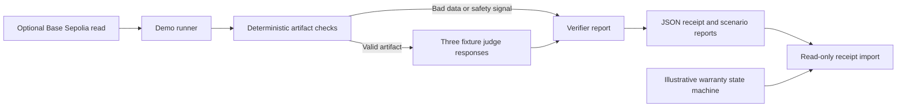

# AgentEscrow architecture

AgentEscrow evaluates a fixed catalog extraction for an agent buying work under an owner’s spending policy. The executable demo exercises the verifier and can read a public stablecoin contract. The browser separately simulates escrow and warranty accounting using 10 demo credits.

## Agent decision loop

| Step | Input | Action and output |
| --- | --- | --- |
| 1. Select a service and policy | Owner’s service, worker, asset, lifetime budget, job cap, expiry and revocation settings | Choose the fixed extraction service and an invited worker. The demo supplies this setup as an example. The intended escrow requires the worker to co-sign exact, expiring funding terms. It would reject funding outside the owner’s policy. |
| 2. Read the payment rail when requested | Fixed Base Sepolia RPC, chain ID 84532, and Circle’s test USDC contract | Check the chain ID. Read the contract’s 6-decimal precision and nonzero supply at a finalized block by hash. Store RPC, block, contract and result in `receipt.chainRead`. Any invalid response stops live mode before grading. The offline path marks the read as skipped and uses no network. |
| 3. Check the delivered artifact | `artifact`, `context`, and `phase` | Bind the revision to a short-lived context. Check schema, snapshot hash and source, exact prices, and stock flags. Flag common injection patterns. Bad data produces a refund recommendation. A safety signal produces no verdict. Both skip the judges. |
| 4. Judge free text | Fixed catalog, artifact and the `faithfulness` and `delivery_caveat` checks | Parse all three responses. Each criterion needs at least two scores of 85 or higher. Three valid responses are mandatory. A detected injection, missing judge, malformed reply, or expired context produces no verdict. The demo injects fixture responses at the provider boundary. |
| 5. Generate evidence | Per-check results and bound task context | On delivery, approval recommends `release`. On repair, approval recommends `accept_repair`. Failed quality recommends `refund`. The report includes hashes and unsigned verdict fields. The named verifier would have to compare the fields with current task state before authorizing any settlement. The demo stops at the recommendation. |
| 6. Model a warranty claim | Owner’s claim and an actual revised artifact | The viewer simulates a 90% release and 10% hold. It offers dismissal, one repair, or deadline refund. The runner separately evaluates revision 2 and verifies its hash differs from revision 1. The viewer offers acceptance or refund of the simulated hold. |

## Verifier contract

`verifyArtifact()` takes an artifact with exact fields `revision`, `snapshotHash`, `source`, `rows`, and `summary`. It takes a context with `network`, `genesisHash`, `program`, `task`, `revision`, `policyVersion`, and `expiry` in Unix seconds, plus `phase` set to `delivery` or `repair`. A context mismatch throws before grading. The local runner supplies inert addresses and the legacy Solana-devnet domain because the original verifier schema requires them. They identify the fixture only. Base Sepolia read evidence has its own fields and never enters the verifier’s legacy signing domain.

The result envelope contains `contractVersion`, `componentId`, `requestId`, `runId`, `status`, `result`, `errors` and `trace`. A report can succeed in processing while rejecting on quality or safety. For payment logic use `result.outcome` and `result.decision`, never `status` alone. `result.verdict` is null on safety or availability failures. When present it binds context, revision, artifact and criteria hashes, phase, decision and report hash. `verifyReportHash()` checks canonical serialization and agreement between the report and verdict fields. A digest proves consistency of the supplied bytes. Authenticity requires a trusted signer or an independently authenticated source.

## Safety limits

### What runs

- The runner sends only fixed `eth_chainId`, `eth_getBlockByNumber`, and `eth_call` requests to the public Base Sepolia RPC when explicitly enabled. Each call has a 10-second timeout and rejects redirects. Contract reads share a canonical finalized block hash. The RPC remains a trusted source for these observations.
- Node’s built-ins handle parsing and hashing. The browser has no wallet integration and sends no API requests. Imported receipts stay local and are rendered as text. A legacy transaction link, if present, uses a fixed explorer origin and requires a signature-shaped value. A link does not authenticate the receipt.
- The original verifier caps artifact JSON at 16 KiB and the summary at 2,048 characters, and rejects mismatched schemas and revisions. Its hosted inference client targets a fixed HTTPS endpoint with bounded time and response sizes, strict JSON, and no tools for judges. The demo supplies no real credentials and makes no inference calls.
- Injection detection is heuristic and can miss attacks. Fixtures prove control flow, schema checks and failure handling. They give no measure of real-model accuracy, independence, prompt-injection resistance or service availability.
- The read-only demo never invokes a signer. There is no usable stablecoin wallet, authorization for a transfer, automatic trading, or payout in this entry.

### What the proposed settlement enforces

- Owner-defined lifetime budget, per-job price cap, worker and asset allowlist, expiry and revocation. Revocation stops new funding. Refunds go to the owner and do not replenish the lifetime spend allowance. Network fees are separate from service-price limits.
- Separate delivery, review, warranty, repair, and final adjudication deadlines agreed at funding. Missed delivery or review leads to refund. An unclaimed warranty can pay the worker after expiry. A disputed hold can refund after the relevant terminal deadline. Settlement needs a caller. There is no automatic keeper.
- One repair per claim. A reviewer evaluates the new artifact and a new revision hash. A stale verdict must fail. Only the designated verifier’s signature could authorize the corresponding transition in a settlement adapter. Judges never hold spending keys.
- The 90/10 split and timeout paths are simulated in the viewer. The budget policy and onchain controls are design constraints for a future settlement integration. The read-only demo offers no deployment or live escrow guarantees.
